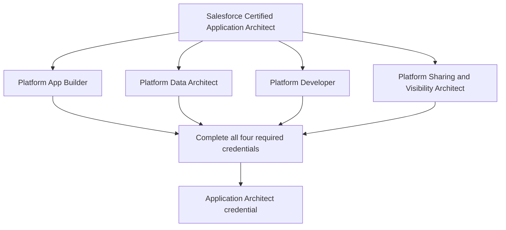
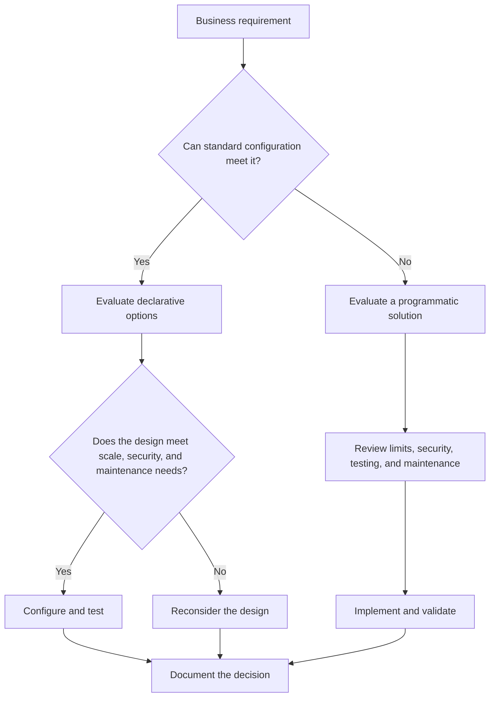
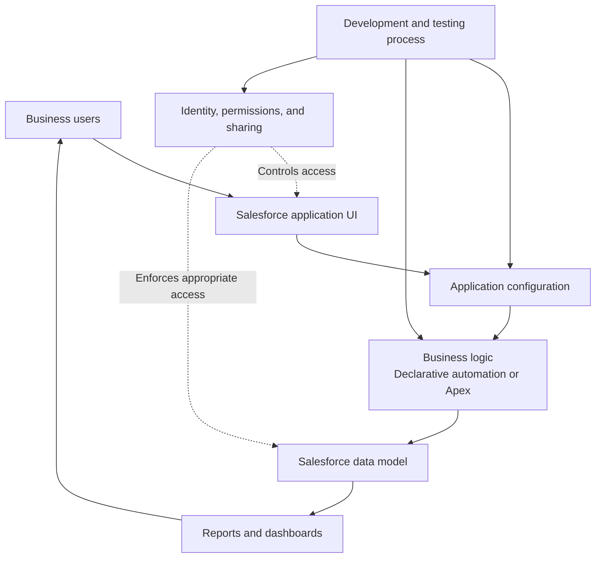
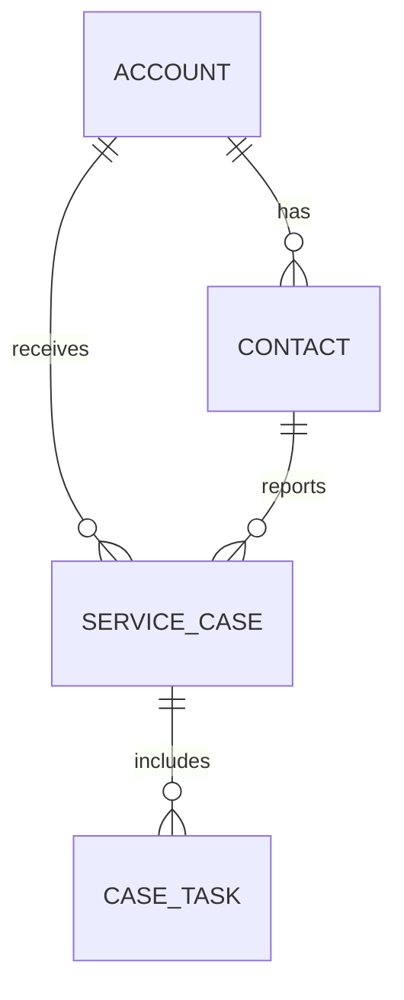
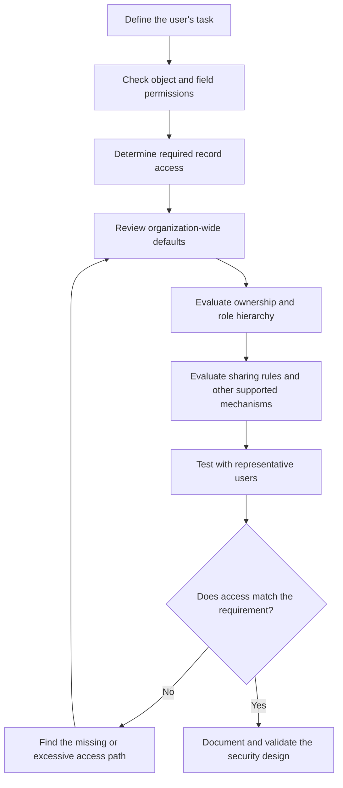
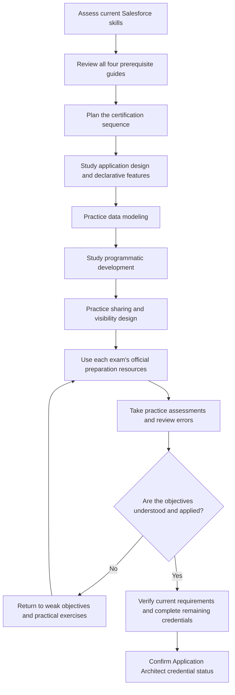
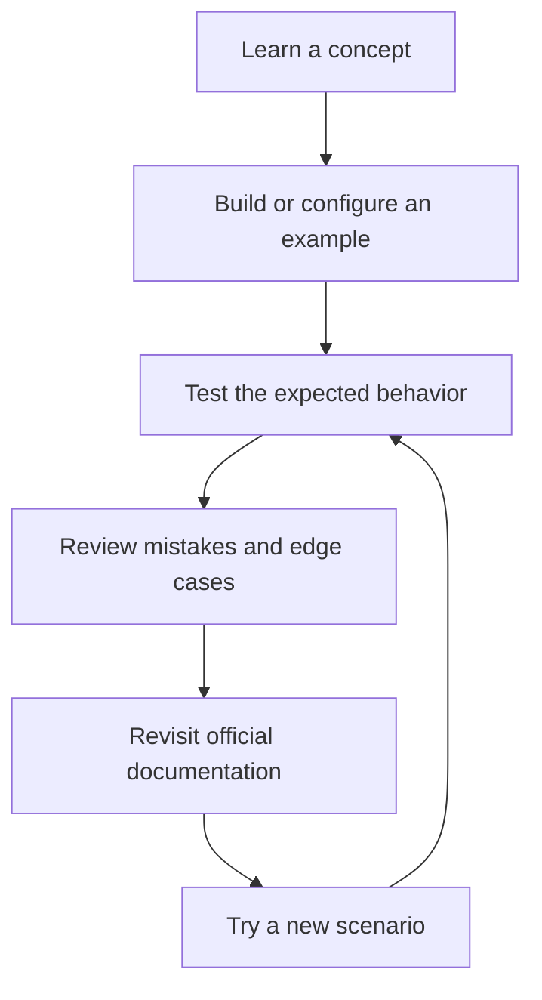

# Salesforce Certified Application Architect — Study Guide

A practical learning resource for the **Salesforce Certified Application Architect** credential. This repository explains the credential pathway, the four required certifications, core Salesforce application architecture concepts, and a structured approach to preparation.

Application architecture is about making design decisions that remain reliable as a Salesforce organization grows. That includes choosing between declarative and programmatic solutions, modeling business data, controlling record access, and ensuring that applications meet business requirements without becoming unnecessarily complex.

This guide combines official Salesforce resources, independent study recommendations, illustrative Mermaid diagrams, practical exercises, and original learning questions. Learners can also explore [CertsGate](https://certsgate.com/) for supplementary IT certification preparation material.

> **Important:** Application Architect is a credential earned by completing four prerequisite certifications. It is not a separate standalone exam. Use the official Salesforce certification pages to verify current requirements and each prerequisite exam's objectives.

## Table of Contents

- [About the Certification](#about-the-certification)
- [Who Should Follow This Path?](#who-should-follow-this-path)
- [How to Earn the Credential](#how-to-earn-the-credential)
- [The Four Required Certifications](#the-four-required-certifications)
- [Core Architecture Skills](#core-architecture-skills)
- [Conceptual Architecture Diagram](#conceptual-architecture-diagram)
- [Data Modeling and Relationships](#data-modeling-and-relationships)
- [Sharing and Visibility Decision Flow](#sharing-and-visibility-decision-flow)
- [Preparation Roadmap](#preparation-roadmap)
- [Study and Revision Cycle](#study-and-revision-cycle)
- [Suggested Study Schedule](#suggested-study-schedule)
- [Hands-On Projects](#hands-on-projects)
- [Original Practice Questions](#original-practice-questions)
- [How to Review Mistakes](#how-to-review-mistakes)
- [Common Preparation Mistakes](#common-preparation-mistakes)
- [Career Relevance](#career-relevance)
- [Frequently Asked Questions](#frequently-asked-questions)
- [Official and Additional Resources](#official-and-additional-resources)
- [About CertsGate](#about-certsgate)

## About the Certification

The Salesforce Certified Application Architect credential recognizes a broad understanding of native Salesforce platform capabilities, data modeling, and sharing mechanisms. Salesforce describes Application Architects as professionals who understand role hierarchies, data, and appropriate ways to control access.

The credential brings together four areas of expertise:

1. **Declarative application design** — configuring and extending applications with platform capabilities.
2. **Data architecture** — designing sound, scalable data models for business requirements.
3. **Programmatic development** — understanding how to implement custom logic and interfaces.
4. **Sharing and visibility** — designing access controls that protect records while allowing appropriate collaboration.

These areas are closely connected. A data model affects reporting and application behavior; automation affects how records are created and updated; and security decisions affect which users can view or modify those records.

Official overview: [Salesforce Certified Application Architect](https://trailhead.salesforce.com/credentials/applicationarchitect)

## Who Should Follow This Path?

This learning path can be useful for:

- Salesforce administrators moving toward application design.
- Platform developers who want broader architectural knowledge.
- Consultants designing Salesforce solutions for business requirements.
- Data modelers working with Salesforce objects and relationships.
- Professionals responsible for record access and application security.
- Experienced Salesforce practitioners preparing for broader architect responsibilities.

Because the credential requires four certifications, it is best approached as a learning journey rather than a single exam-preparation sprint. Review your current knowledge and select a realistic order for completing the prerequisites.

## How to Earn the Credential

Salesforce lists four prerequisite certifications for Application Architect. Completing all four grants the Application Architect credential; there is no additional standalone Application Architect exam listed as part of this pathway.

The diagram summarizes the prerequisite structure; it does not represent a required exam order.

Check the official prerequisite listing before starting, especially if you already hold older Salesforce credentials or are using a study plan created under an earlier certification structure.

Official source: [Salesforce Certification Prerequisites](https://help.salesforce.com/s/articleView?id=005298872&language=en_US&type=1)

## The Four Required Certifications

Each prerequisite has its own exam guide, objectives, preparation materials, and exam policies. Do not assume that all four exams have the same format, passing score, duration, or price.

### 1. Salesforce Certified Platform App Builder

Official page: [Platform App Builder](https://trailhead.salesforce.com/credentials/platformappbuilder)

This certification focuses on designing, building, and implementing custom applications using declarative Salesforce platform capabilities.

Study areas to investigate in the current exam guide include:

- Data modeling and application design.
- Objects, fields, relationships, and page layouts.
- Business logic and automation.
- User experience and application configuration.
- Reports, dashboards, and other platform features.
- Choosing appropriate declarative solutions for business needs.

**Practice objective:** Build a small business application using configuration wherever it meets the requirements. Explain when a declarative solution is appropriate and when another approach may be necessary.

### 2. Salesforce Certified Platform Data Architect

Official page: [Platform Data Architect](https://trailhead.salesforce.com/credentials/platformdataarchitect)

This certification focuses on designing sound, scalable, high-performing solutions for enterprise data management on Salesforce.

Study relevant concepts such as:

- Object and relationship design.
- Data volume and performance considerations.
- Data quality and data migration.
- Data access and ownership implications.
- Modeling requirements for reporting and business processes.
- Evaluating the trade-offs of different data structures.

**Practice objective:** Design a data model for a business scenario and explain how the relationships, data volume, and access requirements influence your decisions.

### 3. Salesforce Certified Platform Developer

Official page: [Platform Developer](https://trailhead.salesforce.com/credentials/platformdeveloperi)

This certification covers the programmatic capabilities of the Salesforce platform, including custom business logic and interfaces. Salesforce identifies Apex and Visualforce among the technologies associated with this credential.

Preparation should include the subjects specified in the current official exam guide. Depending on those objectives, relevant practice may involve:

- Apex language fundamentals.
- Triggers and execution behavior.
- Data access and manipulation.
- Testing and debugging.
- Declarative versus programmatic solution choices.
- Custom interfaces and platform extension patterns.

**Practice objective:** Implement a small business rule, test expected and unexpected cases, and explain why the chosen implementation fits the requirements.

### 4. Salesforce Certified Platform Sharing and Visibility Architect

Official page: [Salesforce Architect Overview](https://trailhead.salesforce.com/credentials/architectoverview)

This certification focuses on designing secure, scalable solutions that meet Salesforce sharing and visibility requirements.

Study the current exam guide and practice concepts such as:

- Organization-wide defaults.
- Role hierarchies.
- Ownership-based access.
- Sharing rules and other supported sharing mechanisms.
- Profiles, permission sets, and object permissions.
- Record-level access requirements.
- Security trade-offs and troubleshooting access problems.

**Practice objective:** Given a set of users and record-access requirements, design a model that grants the necessary access without giving every user broad visibility.

For all four certifications, the current official exam guide should determine the detailed objectives and policies.

## Core Architecture Skills

Application architecture requires looking at the complete solution rather than considering each feature in isolation.

| Skill area | Key question | Practical exercise |
|---|---|---|
| Application design | Can the requirement be met with standard platform features? | Build a small application with declarative configuration |
| Data architecture | Does the data model represent the business accurately? | Model customers, accounts, orders, and relationships |
| Development | Is custom logic necessary, and can it be tested reliably? | Implement and test a business rule |
| Sharing and visibility | Can each user access only the records they need? | Design a record-access model |
| Maintainability | Will the solution remain understandable as requirements grow? | Document assumptions and design trade-offs |
| Testing | Can the design be validated against realistic scenarios? | Create positive, negative, and access-control test cases |

### Declarative or programmatic?

A useful architecture decision is choosing between configuration and custom code.

This is an independent decision aid, not a formal Salesforce-mandated decision tree. The right approach depends on the requirement, platform capabilities, operational constraints, and long-term maintenance needs.

## Conceptual Architecture Diagram

The following diagram shows how application behavior, data design, business logic, and access controls fit together in a Salesforce solution. It is an illustrative learning model, not a claim about a single required Salesforce deployment architecture.

### How to interpret the diagram

- **Application configuration** defines the user-facing experience and supported platform behavior.
- **Business logic** handles the rules that determine how records and processes behave.
- **Data modeling** determines how business information is represented and related.
- **Security controls** influence which actions and records are available to each user.
- **Reports and dashboards** present information based on the data and access available to their users.
- **Development and testing** help ensure that changes behave as intended.

A sound design considers these elements together. For example, a technically correct automation can still produce an unsuitable result if the data model is wrong or access requirements were overlooked.

## Data Modeling and Relationships

Data architecture is not just a question of which fields to create. It also involves deciding how records relate, how data is maintained, and how the structure supports business processes.

A simplified example for a service business might look like this:

This conceptual model illustrates possible business relationships. The object names and relationships are examples, not a prescribed Salesforce schema.

When designing a model, ask:

- Does each object represent a clear business concept?
- Are relationships consistent with the real business rules?
- Will users need to report across these relationships?
- Could record volume affect performance or operational choices?
- How will data quality be maintained?
- What access should different users have to these records?

For practice, create a small data model and document why each relationship was selected. Then consider how the design might change if the business adds another region, a new customer type, or a different ownership process.

## Sharing and Visibility Decision Flow

Security design begins with requirements: who needs access, to which records, and for what purpose?

Salesforce uses multiple layers of permissions and record-sharing behavior. The appropriate combination depends on the object, the operation, the user's permissions, ownership, hierarchy, and configured sharing mechanisms.

Use this flow as a study aid, not as a complete specification of Salesforce's access evaluation. Confirm exact platform behavior in official documentation.

For a practical exercise, create three user personas:

- A sales representative who should see their own assigned records and other explicitly shared records.
- A manager who needs appropriate access to the team's records.
- An operations user who needs access to a defined subset of records for a separate process.

Write down the intended access before configuring the solution. Then test both allowed and denied operations. Good security testing verifies that users can do what they need and cannot do what they should not.

Official learning resource: [Optimize Salesforce Role Hierarchies for Data Security](https://trailhead.salesforce.com/content/learn/modules/data_security/data_security_roles)

## Preparation Roadmap

Because Application Architect requires four certifications, prepare in stages. The roadmap below is an independent recommendation; Salesforce does not require candidates to follow this particular order.

### Stage 1: Establish your baseline

List the four prerequisite certifications and mark your current status for each. Identify whether your experience is strongest in administration, development, data modeling, or security.

### Stage 2: Study the official objectives

Read the current guide for each prerequisite before selecting practice material. Keep each guide's objectives separate so that you do not confuse the scope of one exam with another.

### Stage 3: Practice in a Salesforce environment

Use a suitable development or practice environment to build applications, model data, implement business logic, and test access behavior. Record the assumptions behind each design decision.

### Stage 4: Assess your readiness for each prerequisite

Use official learning materials, practical exercises, and appropriately selected practice questions. Revisit any objective that you cannot explain clearly or apply to a new scenario.

### Stage 5: Complete and verify the pathway

Follow the current registration and certification requirements for each prerequisite. Once all four have been completed, check your Salesforce credential record to confirm that the Application Architect credential has been awarded.

## Study and Revision Cycle

Preparation works best as a repeated cycle rather than a one-time review.

For example, after studying record access, test the same record with users who have different permissions and roles. If the results differ from your expectations, investigate the access model and the relevant documentation instead of memorizing a single outcome.

Use the same method for data relationships, automation, and programmatic logic.

## Suggested Study Schedule

The following eight-week schedule is an independent planning example, not an official Salesforce timeline. It assumes you can study across all four prerequisite areas; adapt it to your existing credentials and experience.

| Week | Focus | Suggested outcome |
|---|---|---|
| 1 | Review the pathway and assess your skills | A prerequisite checklist and study plan |
| 2 | Declarative application design | A small configured business application |
| 3 | Data architecture | A documented object and relationship model |
| 4 | Programmatic development | A tested example of custom business logic |
| 5 | Sharing and visibility | An access model tested with different user personas |
| 6 | Review official objectives and revisit weak areas | A topic-by-topic progress record |
| 7 | Practice assessments and scenario-based exercises | An error log with corrective actions |
| 8 | Final revision and certification logistics | A readiness review for the next prerequisite exam |

This schedule is not a guarantee that the entire pathway can be completed in eight weeks. Each prerequisite is a separate certification, and your experience and availability will affect the timeline.

## Hands-On Projects

These projects are independent learning exercises designed to connect the certification domains.

### Project 1: Build a declarative business application

**Scenario:** A service company needs to track customers, service requests, and request status.

Tasks:

- Define the required objects and fields.
- Establish appropriate relationships.
- Configure the user experience.
- Implement supported declarative automation.
- Create a report or dashboard for operational visibility.
- Document which requirements are met by configuration.

**What to evaluate:** Whether the application meets the stated requirements without unnecessary complexity.

### Project 2: Design a scalable data model

**Scenario:** The company expects more customers, more service records, and additional reporting needs.

Tasks:

- Draw an entity relationship diagram.
- Define relationships and key fields.
- Identify potential data-quality risks.
- Consider reporting requirements.
- Document assumptions about data volume and ownership.
- Explain trade-offs in the model.

**What to evaluate:** Whether the model reflects the business and can support expected use cases.

### Project 3: Implement and test business logic

**Scenario:** A service request must meet a defined business rule before a status change is accepted.

Tasks:

- Define the rule and its edge cases.
- Decide whether declarative or programmatic implementation is suitable.
- Implement the behavior in a practice environment.
- Test valid and invalid inputs.
- Document expected results and failure cases.

**What to evaluate:** Correct behavior, maintainability, and adequate testing.

### Project 4: Create a sharing and visibility model

**Scenario:** Representatives, managers, and operations users need different access to customer and service records.

Tasks:

- Define access requirements for each persona.
- Establish appropriate baseline access.
- Evaluate ownership, hierarchy, and sharing mechanisms.
- Test allowed and denied access.
- Document any assumptions and exceptions.

**What to evaluate:** Whether the solution meets business needs without unnecessary exposure of records.

### Project 5: Write an architecture decision record

Choose one design decision from the previous projects and document:

- The business problem.
- The constraints and assumptions.
- The options considered.
- The selected approach.
- The trade-offs.
- The security and maintenance implications.
- The tests needed to validate the design.

This exercise develops the habit of explaining why a design was chosen, not just documenting what was configured.

## Original Practice Questions

The following questions are original educational examples. They are not official Salesforce exam questions and are not intended to predict live exam content.

<strong>Question 1: Credential pathway</strong>

What is the defining characteristic of the Salesforce Certified Application Architect credential?

A. It is earned by passing one standalone Application Architect exam.  
B. It is earned after completing four prerequisite certifications.  
C. It is awarded automatically after completing a Trailhead module.  
D. It requires only a developer certification.

**Answer: B**

Salesforce identifies four prerequisite certifications: Platform App Builder, Platform Data Architect, Platform Developer, and Platform Sharing and Visibility Architect.

Official reference: [Application Architect Certification](https://trailhead.salesforce.com/credentials/applicationarchitect)

<strong>Question 2: Declarative or programmatic design</strong>

A requirement can be met by standard platform configuration. What should the architect do first?

A. Write custom code without evaluating alternatives.  
B. Evaluate whether the declarative approach meets the requirements and constraints.  
C. Avoid testing because the platform provides the feature.  
D. Redesign the data model without reviewing the requirement.

**Answer: B**

An architect should assess suitable options against the actual requirement, including security, maintainability, and platform constraints. The presence of a declarative feature does not remove the need for testing.

<strong>Question 3: Data architecture</strong>

A business needs to represent customers and the service requests associated with them. What should guide the relationship design?

A. The number of objects in another organization's implementation.  
B. The business rules, reporting needs, and expected record relationships.  
C. A preference to avoid all relationships.  
D. The color scheme of the application.

**Answer: B**

The data model should reflect business concepts and expected use. Reporting needs, data quality, ownership, and scale can all affect the design.

<strong>Question 4: Access control</strong>

A user can open an object but cannot see a particular record. What is a reasonable troubleshooting approach?

A. Assume the record is deleted.  
B. Review object permissions, record access, ownership, hierarchy, and applicable sharing mechanisms.  
C. Give every user unrestricted access.  
D. Change the record's name.

**Answer: B**

Access can depend on multiple permission and sharing layers. Investigate the specific user's access and the record's sharing context before making changes.

<strong>Question 5: Testing custom logic</strong>

A custom business rule works for one record but behaves unexpectedly when several records are processed together. What should the developer do?

A. Test only the single-record case again.  
B. Review the implementation and test realistic bulk scenarios and edge cases.  
C. Remove all tests.  
D. Assume the behavior will never occur in production.

**Answer: B**

Testing should cover realistic execution scenarios, including bulk operations where relevant, error cases, and expected platform behavior. The exact test strategy depends on the implementation.

<strong>Question 6: Architecture documentation</strong>

Two designs satisfy the immediate business requirement, but one has more maintenance overhead. What should the architect document?

A. Only the design's name.  
B. The decision, alternatives, assumptions, trade-offs, and reasons for the selection.  
C. Only the implementation date.  
D. Nothing, if the first test passes.

**Answer: B**

Architecture decisions should explain why an approach was selected and which trade-offs were accepted. This helps future teams maintain or revisit the design.

### How to use these questions

For every answer:

1. Explain why the selected option is appropriate.
2. Explain why the alternatives do not fit as well.
3. Identify the relevant certification objective.
4. Reproduce the concept in a practice environment where possible.
5. Try a different scenario to confirm the reasoning.

Use practice questions to identify gaps, not as a substitute for the current official exam guides.

## How to Review Mistakes

Maintain an error log for each prerequisite certification.

| Topic | Mistake or uncertainty | Review action |
|---|---|---|
| Data modeling | Unsure which relationship represents the business rule | Draw a small model and test example records |
| Declarative design | Unsure whether configuration is sufficient | Compare supported options and constraints |
| Programmatic development | Code works only for a narrow scenario | Review edge cases and test broader inputs |
| Record access | A user receives more or less access than expected | Trace the relevant permissions and sharing behavior |
| Architecture decisions | Cannot explain why an option was selected | Record alternatives, assumptions, and trade-offs |

These are illustrative examples, not reported exam questions.

When reviewing mistakes, prioritize recurring gaps and concepts that affect multiple areas. For instance, a poor data model can affect automation, reporting, and access decisions at the same time.

## Common Preparation Mistakes

### Treating Application Architect as a single exam

The credential is earned by completing four prerequisite certifications. Plan and track each certification separately.

### Studying from one exam guide for all four prerequisites

Each certification has its own scope. Use the current official guide for the specific exam you are preparing for.

### Memorizing features without understanding trade-offs

Architecture questions often require choosing an approach for a particular set of requirements. Learn why a solution fits, what it costs to maintain, and what limitations it introduces.

### Ignoring practical exercises

Reading about relationships, automation, or sharing is not the same as building and testing them. Practice with realistic examples.

### Overlooking security

A solution that works functionally may still be unsuitable if it exposes records or actions to the wrong users. Include security requirements early in the design.

### Using outdated preparation materials

Salesforce may update certification requirements, exam objectives, product behavior, and learning resources. Compare third-party material with the latest official pages.

### Repeating tests without analyzing mistakes

A score alone does not show whether the underlying concepts are understood. Review incorrect and uncertain answers before moving to another assessment.

## Career Relevance

Application architecture skills can support work involving Salesforce solution design, platform development, consulting, data modeling, and security architecture.

The credential may help demonstrate a broad foundation across several platform areas, but it does not replace project experience or the ability to explain and defend architectural decisions.

Practical work can help you demonstrate that you can:

- Translate business requirements into platform designs.
- Choose between declarative and programmatic solutions.
- Build data models that support operational and reporting needs.
- Evaluate security and record-visibility requirements.
- Test application behavior and document trade-offs.
- Collaborate with administrators, developers, and business stakeholders.

Keep a portfolio of practice projects and architecture decision records using data and environments you are authorized to use.

## Frequently Asked Questions

### Is Salesforce Certified Application Architect a standalone exam?

No. Salesforce lists Application Architect as a credential earned after completing four prerequisite certifications.

### Which certifications are required?

The official prerequisite list names:

1. Salesforce Certified Platform App Builder.
2. Salesforce Certified Platform Data Architect.
3. Salesforce Certified Platform Developer.
4. Salesforce Certified Platform Sharing and Visibility Architect.

Confirm the current list on the [Salesforce prerequisite page](https://help.salesforce.com/s/articleView?id=005298872&language=en_US&type=1).

### Does Application Architect have its own exam code or passing score?

It is not a standalone exam in the published credential pathway, so a separate Application Architect exam code, question count, duration, passing score, and domain-weight chart do not apply in the same way they do to its prerequisite exams. Each prerequisite has its own official exam information.

### Is there a required order for the four certifications?

The official Application Architect overview lists the prerequisites but does not establish the study order used in this repository. Choose an order that fits your background, and verify the current registration requirements for each exam.

### How long does the entire pathway take?

There is no single timeline that fits every candidate. Your existing certifications, experience, available study time, and familiarity with the exam objectives will affect the duration.

### Should I focus on theory or hands-on practice?

Use both. Official documentation provides the reference material, while practical exercises help you apply the concepts, identify mistakes, and understand design trade-offs.

### Are the practice questions in this repository official?

No. They are original educational questions intended to reinforce general architecture concepts. They are not official or leaked exam questions.

### Can CertsGate replace Salesforce's official resources?

No. CertsGate can supplement preparation with relevant study guides and practice materials, but Salesforce's official pages should remain the source of truth for certification requirements and exam objectives.

## Official and Additional Resources

### Salesforce certification pages

- [Salesforce Certified Application Architect](https://trailhead.salesforce.com/credentials/applicationarchitect) — overview of the credential and its prerequisite certifications.
- [Salesforce Certification Prerequisites](https://help.salesforce.com/s/articleView?id=005298872&language=en_US&type=1) — official prerequisite listing.
- [Salesforce Architect Overview](https://trailhead.salesforce.com/credentials/architectoverview) — broader architect certification portfolio.

### Prerequisite certification resources

- [Platform App Builder](https://trailhead.salesforce.com/credentials/platformappbuilder) — declarative application design and configuration.
- [Platform Data Architect](https://trailhead.salesforce.com/credentials/platformdataarchitect) — enterprise data architecture and management.
- [Platform Developer](https://trailhead.salesforce.com/credentials/platformdeveloperi) — custom logic and programmatic platform capabilities.
- [Architect Overview: Sharing and Visibility](https://trailhead.salesforce.com/credentials/architectoverview) — find the Platform Sharing and Visibility Architect credential and its current preparation resources.

### Official learning and technical documentation

- [Salesforce Trailhead](https://trailhead.salesforce.com/) — guided learning modules and trails.
- [Salesforce Help](https://help.salesforce.com/) — current product and certification documentation.
- [Salesforce Developer Documentation](https://developer.salesforce.com/docs) — developer references and technical guidance.
- [Salesforce Role Hierarchy and Data Security](https://trailhead.salesforce.com/content/learn/modules/data_security/data_security_roles) — learning material about role hierarchies and record access.

Before registering for any prerequisite exam, open its official certification page and follow the current exam-guide link. Confirm objectives, fees, delivery options, and maintenance requirements directly with Salesforce.

### Independent supplementary resources

- [CertsGate](https://certsgate.com/) — explore available IT certification study guides, practice questions, and other preparation material.

Use third-party material to reinforce learning and identify gaps. Verify technical details and exam-specific requirements against the official sources.

## About CertsGate

[CertsGate](https://certsgate.com/) is an independent IT certification preparation resource. Depending on the materials available for a particular exam, learners may find study guides, practice questions, mock-test-style exercises, and related learning resources.

For the Application Architect pathway, supplementary practice is most useful when it helps you understand the four prerequisite subject areas and apply them to realistic design scenarios. Pair third-party materials with Salesforce documentation, hands-on exercises, and the official guide for each exam.

This repository does not claim that CertsGate is an official Salesforce provider or partner.
